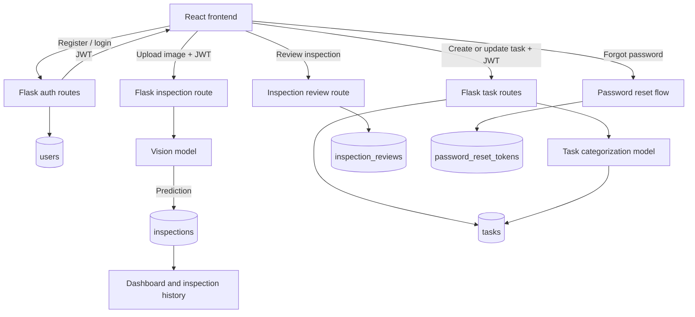
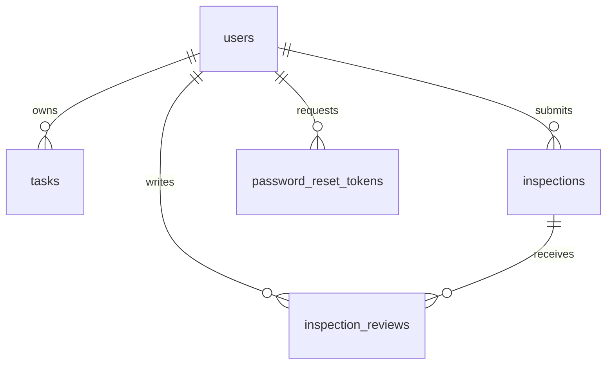

# CathodeVision AI System Flow

## Request flow

## Database relationships

## Persisted flow

1. A user registers. The password is hashed before it is stored in `users`.
2. The user logs in and receives a JWT. Protected requests use that token.
3. An authenticated user uploads an image. The AI result is stored in `inspections`.
4. Dashboard and inspection-history queries aggregate only that user’s rows.
5. A reviewer can record a correction in `inspection_reviews` without changing the original AI result.
6. Password-reset requests are represented by expiring, one-use token records in `password_reset_tokens`.
7. Tasks remain user-owned records in `tasks`; AI categorization updates the task’s category fields.